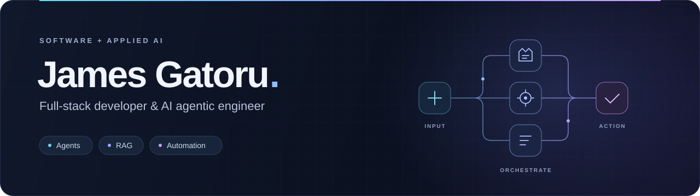

  

<h1 align="center">Full-stack development. Applied AI.</h1>

  I’m James, a software developer based in Kenya. 
  I build web applications and AI workflows that connect people, data, and tools.

  
  &nbsp;
  
  &nbsp;
  

---

### A little about me

My work spans responsive interfaces, backend services, and business platforms. These days, I’m bringing that foundation into AI: building systems that can retrieve context, use tools, and carry work through to completion.

I’ve built applications for logistics, legal practice, public-sector case management, and education, alongside AI platforms and supervised multi-agent workflows.

Away from the keyboard, I’m still an anime and comics nerd.

### Where AI fits into my work

- **Agents**: Multi-agent workflows, tool integrations, orchestration, and human approval gates.
- **RAG**: Connecting language models to relevant knowledge through retrieval-augmented generation.
- **Automation**: Connecting APIs, data, and business processes to reduce repetitive work.

I care about what happens beyond the prompt: reliable execution, useful interfaces, and people staying in control.

### Tools I work with

#### Frontend

  
  
  
  
  

#### Backend &amp; data

  
  
  
  
  
  

#### AI &amp; automation

  
  
  

Agents · RAG · Workflow orchestration · API integrations

#### Delivery

  
  
  

#### Design

  
  
  
  

  
<strong>A bit more of my toolkit</strong>

  Generative AI, LoRA fine-tuning, dataset curation, AI governance, and WordPress.

  **Certification:** Microsoft Certified: Power Platform Developer Associate (PL-400).

### My stats

  

  

---

Have an interesting product or workflow in mind? [Let’s talk →](mailto:gatorumbugua@gmail.com)
